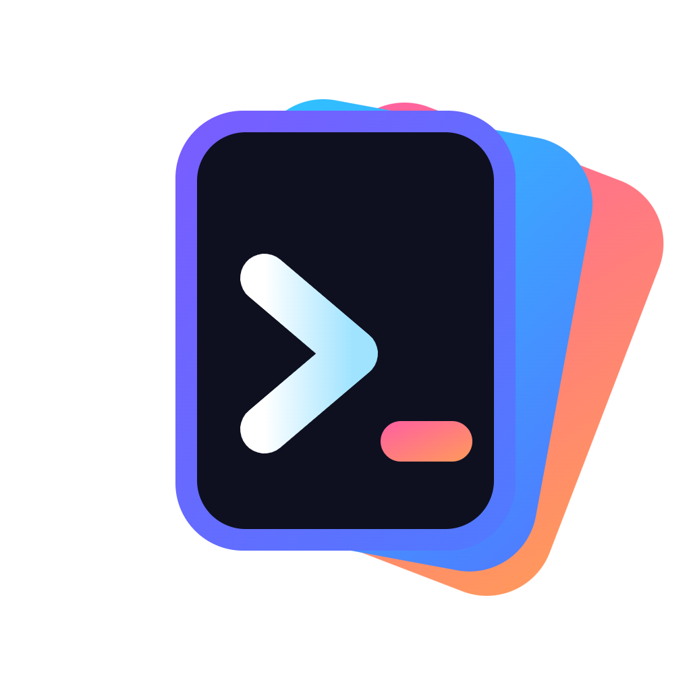
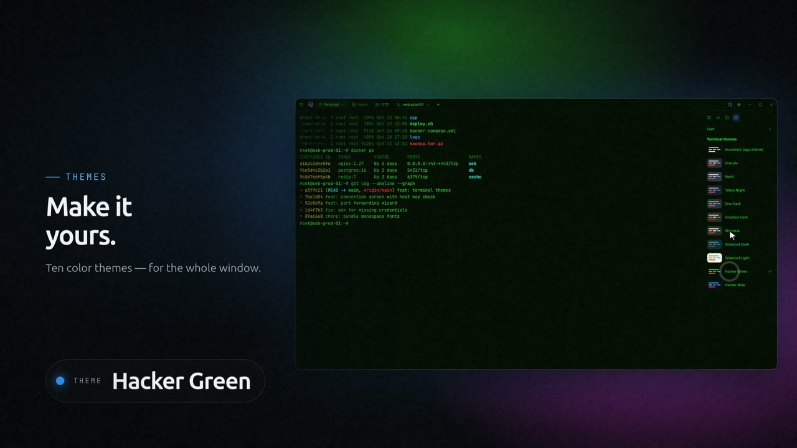
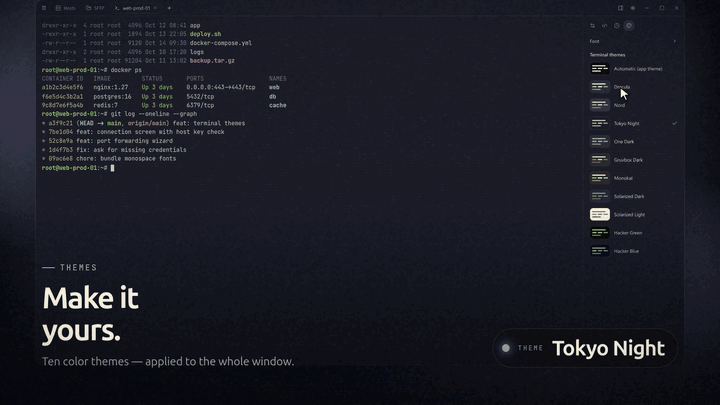
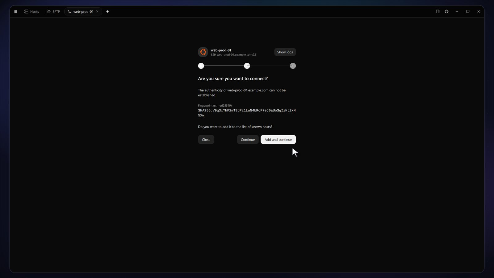
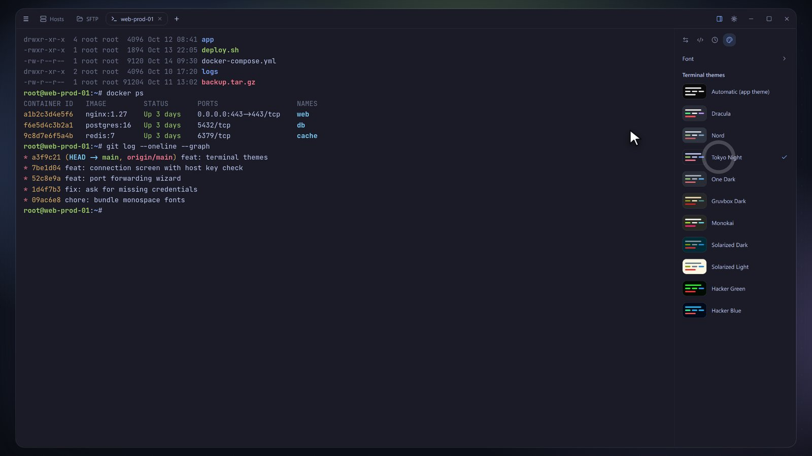
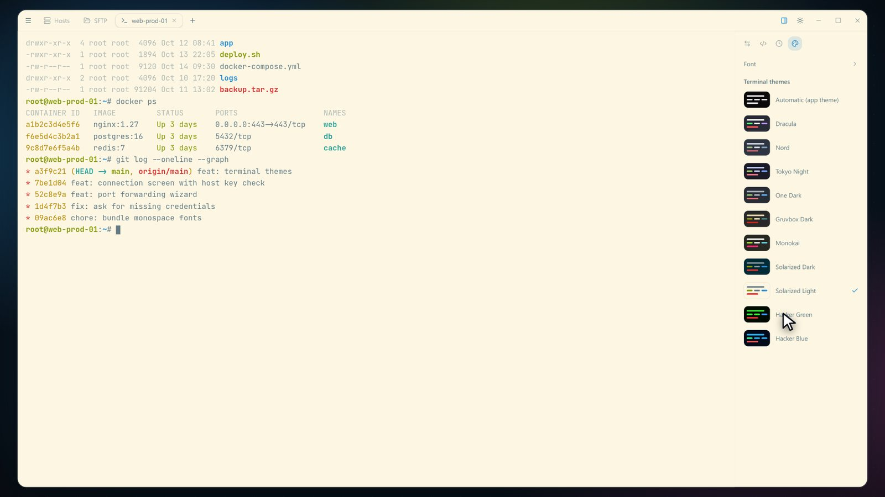
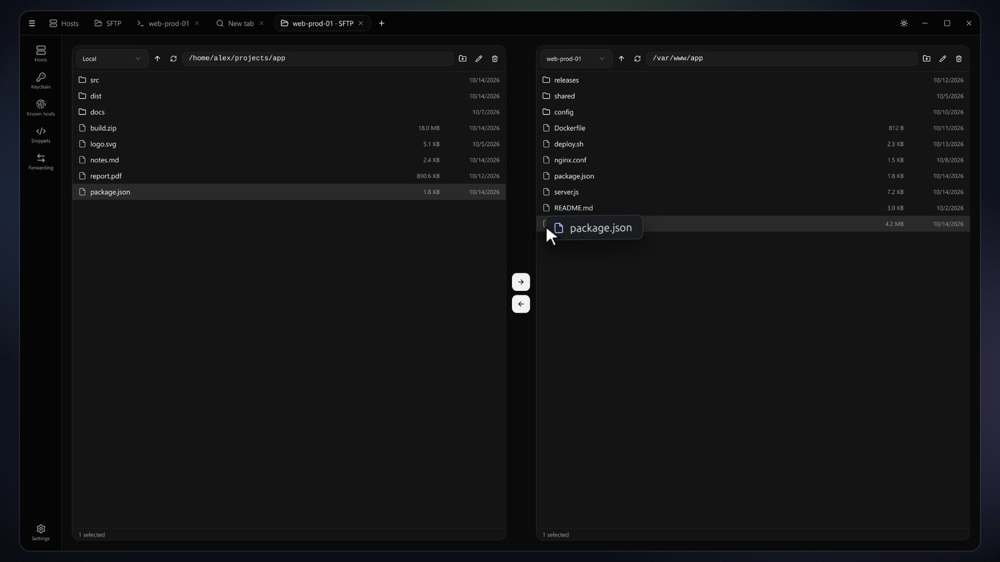
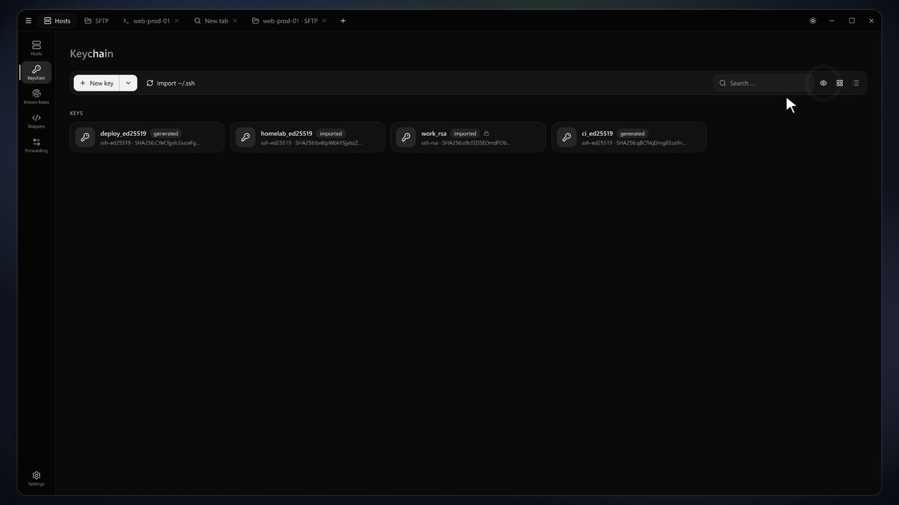
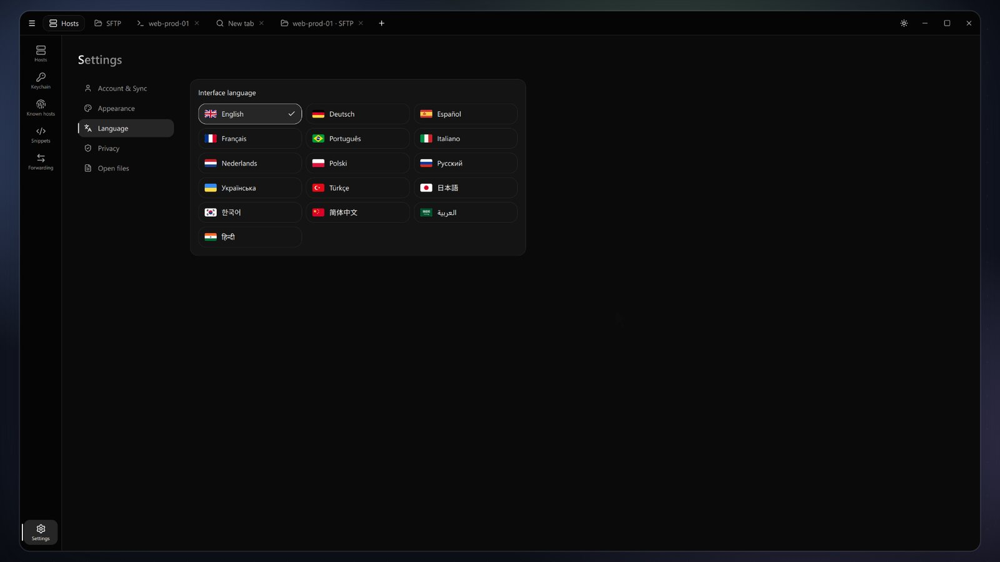

<p align="center">
  
</p>

<h1 align="center">SSH Deck</h1>

<p align="center">
  <b>An SSH client for people who live in the terminal.</b><br>
  Tabs and split panes, ten terminal themes, SFTP with drag &amp; drop, keychain, port forwarding, jump hosts, proxy chains, end-to-end encrypted sync, optional Tor. Desktop and Android. 16 languages.
</p>

<p align="center">
  <a href="https://github.com/HyperGaming99/ssh-deck/releases/latest"></a>
  <a href="https://github.com/HyperGaming99/ssh-deck/actions/workflows/release.yml"></a>
  
</p>

<p align="center">
  <a href="docs/trailer.mp4"></a><br>
  <sub>▶ Watch the 54-second trailer · <a href="#about-the-trailer">how it is made</a></sub>
</p>

## What is SSH Deck?

SSH Deck is a desktop app (Electron + React) to connect to your servers. You keep all hosts in one place, open them as terminal tabs, move files with SFTP and keep keys and fingerprints under control — and everything can sync between your devices without the sync server ever seeing your data.

<p align="center"></p>

## Features

**Terminal**
- Tabs, **split panes** (up to four per tab) and **broadcast**: type once, send to several sessions
- A side panel next to every session with **snippets** (with `{{placeholders}}` that are asked for when you run them), **command history**, **port forwarding** and a **server status** tab (load, memory, disk, uptime)
- **Command suggestions** while you type (commands of the session, your snippets and common commands; accept with <kbd>Ctrl</kbd>+<kbd>Space</kbd> or by tapping; the history stays in memory only), **search** in the output (<kbd>Ctrl</kbd>+<kbd>F</kbd>), **automatic reconnect** after a dropped connection (keepalive, countdown, backoff), and **session recording** to an asciicast `.cast` file
- **Ten terminal themes** (Dracula, Nord, Tokyo Night, One Dark, Gruvbox, Monokai, Solarized, …) that recolor the whole window; bundled monospace fonts with live size preview
- Connection screen with a live log, host key check right in the tab, and **smart login**: it asks only for what the server needs (username, password, key from your keychain, one-time code)

**Hosts**
- Groups, tags, search, **favorites** and a *recently used* section, OS icons that are detected automatically
- Import from `~/.ssh/config`, CSV, PuTTY, MobaXterm and SecureCRT; quick connect with <kbd>Ctrl</kbd>+<kbd>K</kbd>
- **Copy the `ssh` command** of a host or **export hosts as `~/.ssh/config`** entries (no passwords)

**Connection routes** – per host: **jump hosts** (chains of up to three, also for SFTP and forwarding), **proxy chains** (SOCKS4/SOCKS5 one after another, like proxychains; Tor goes first when it is on), **Cloudflare Tunnel** (needs `cloudflared` on your computer) and **Telnet** for old devices

**SFTP** – two panes, drag &amp; drop, server to server, open with your editor and upload edits automatically

**Keychain &amp; Known hosts** – generate or import keys, export them to a host, import `~/.ssh`; fingerprints and host names are masked by default

**Port forwarding** – local, remote and dynamic (SOCKS5), set up with a guided wizard

**Teams** – shared vaults for hosts (with passwords), snippets, forwarding rules and SSH keys. Switch between *Personal* and team vaults in the title bar; owners and admins invite people by email and give them a role (admin, member, viewer). Everything is end-to-end encrypted, removing a member renews the team key, and every member's key fingerprint is shown so invitations can be verified in person. Needs the cloud-sync server (`node server/server.js`) and an account.

**Privacy &amp; sync** – optional cloud sync with end-to-end encryption (the server stores only ciphertext), secrets encrypted with the OS keystore, **Tor routing** for sync and/or servers

**More** – 16 languages (incl. right-to-left), light and dark UI, in-app updater, **Android app** (see below)

## Screenshots

| | |
|---|---|
|  |  |
| Host key check inside the tab | Ten themes, applied to the whole window |
|  |  |
| Light themes work too | SFTP, drag &amp; drop between panes and servers |
|  |  |
| Keychain with masked fingerprints | 16 languages |

## Install

Download an installer from the [latest release](https://github.com/HyperGaming99/ssh-deck/releases/latest):

| System | File |
|---|---|
| Linux | `…linux-x86_64.AppImage` (make it executable and run) or `…linux-amd64.deb` |
| Windows | `…win-x64.exe` |
| macOS | `…mac-arm64.dmg` (Apple Silicon) or `…mac-x64.dmg` (Intel) |

File names look like `ssh-deck-<version>-<last commit>-<system>-<architecture>.<ext>`.

> The installers are **not code-signed yet**: Windows SmartScreen and macOS Gatekeeper will warn on the first start (macOS: right-click → Open).

### Android (preview)

The Android app uses the same interface and the same code as the desktop app: Node.js runs inside the app ([nodejs-mobile](https://github.com/nodejs-mobile/nodejs-mobile)) and talks to a [Capacitor](https://capacitorjs.com) shell. On the phone you get a bottom navigation bar, a key bar for <kbd>Esc</kbd>, <kbd>Tab</kbd>, <kbd>Ctrl</kbd>, <kbd>Alt</kbd> and the arrow keys, and the terminal side panel as an overlay. Sync, teams and the keychain work as on the desktop. The key that protects your secrets is wrapped by the **Android Keystore**; it never lies on the disk in plain form, and Android's auto backup is turned off for the app.

There are no store builds or signed releases yet. To try it, build it yourself (JDK 21, Android SDK with platform 35+, NDK 27.2 and CMake 3.22, Node.js 22):

```bash
bash mobile/fetch-libnode.sh   # one time: downloads the prebuilt Node.js libraries
bash mobile/dev.sh             # builds the web bundle, the Node part and the debug APK, installs it over USB and starts it
```

Not available on the phone: Cloudflare Tunnel (needs `cloudflared`), session recording to a file, the in-app updater and Mosh.

**Run from source** (Node.js 22 or newer):

```bash
git clone https://github.com/HyperGaming99/ssh-deck.git
cd ssh-deck
npm install
npm start        # builds the UI and starts the app
npm test
```

On Linux you can add SSH Deck with its logo to your application menu: `bash assets/install-linux.sh`.

## Sync server

`node server/server.js` (Node.js 22+) runs the account and sync server (`PORT`, `DB_PATH`, `ALLOW_REGISTRATION`, …). For Kubernetes see [`server/k8s`](server/k8s): `bash deploy.sh` creates the namespace `ssh-deck`, a Deployment with a persistent hostPath volume and a NodePort service (30787). Put a TLS-terminating proxy in front of it before exposing it to the internet.

## Updates

*Settings → Updates* checks the newest stable release. For a source install it downloads, checks, installs and restarts the app (with an automatic rollback if something fails); for an installed package it opens the release page. Under *Update channel* you can switch to **Dev**: then pre-releases built from the `dev` branch (a new one with every push) are offered too. The default is **Stable**.

## Development

- Work happens on **`dev`** (or feature branches with a pull request into `dev`). Every push builds installers for Linux, Windows and macOS, bumps the version automatically and publishes a pre-release `v<version>-dev.<run>`.
- The Android part lives in [`mobile/`](mobile) (Node.js side, bridge, build scripts) and [`android/`](android) (Capacitor project, JNI glue under MIT from nodejs-mobile-react-native). `node mobile/test-node.js` checks the phone's Node side on the desktop; it runs as part of `npm test`.
- **`main`** is stable and protected: only pull requests from `dev` can change it, and merging publishes the stable release.
- Release notes list every commit since the previous release and name the last commit. Details: [CONTRIBUTING.md](CONTRIBUTING.md).

Found a bug or have an idea? [Open an issue](https://github.com/HyperGaming99/ssh-deck/issues/new/choose).

## About the trailer

The trailer ([`docs/trailer.mp4`](docs/trailer.mp4), 54 s) is **not a screen recording and not an AI video**. Every frame is rendered from the real app with demo data, so it always matches what the app looks like — and it can be re-rendered whenever the UI changes. The pipeline lives in [`trailer/`](trailer):

1. **Capture** – `capture2.js` starts the built UI in an invisible Electron window with a stub backend (fake hosts, keys and a fake server — never real data), clicks through the app and saves a screenshot of every state, plus the positions of buttons for the mouse cursor.
2. **Timeline** – `timeline2.js` plans the whole film in *bars* of the music: camera moves, cursor path, clicks, typed commands, captions and theme changes. Everything lands on the beat.
3. **Stage** – `stage2.html` is a deterministic scene player. Given a time it draws that exact frame: the app window floating on a colour field that follows the active theme, a live-drawn terminal (typing and colours blend smoothly between themes), camera, cursor and captions. Because it only depends on the time, rendering is repeatable.
4. **Render** – `render.js` steps through the film at 30 fps in headless Electron and encodes it with ffmpeg. `sfx.js` synthesizes clicks, typing, whooshes and pops from the same timeline, and the result is mixed with the music.

```bash
node trailer/capture2.js          # run with: npx electron trailer/capture2.js --no-sandbox
TRAILER=2 node trailer/sfx.js     # sound effects
npx electron trailer/render.js --no-sandbox --stage stage2                 # full film
npx electron trailer/render.js --no-sandbox --stage stage2 --preview 18.4  # single frames
npx electron trailer/render.js --no-sandbox --stage stage2 --clean --preview 18.4  # frame without captions (README images)
```

Needs `ffmpeg` and Node.js 22. The music is **not included**: put your own track at `trailer/music/track.mp3` and run `node trailer/analyze.js` once to detect its tempo, so cuts and camera moves follow the beat. The screenshots in this README come from the same pipeline (`--clean`).

## License

No license has been chosen yet — all rights reserved.
